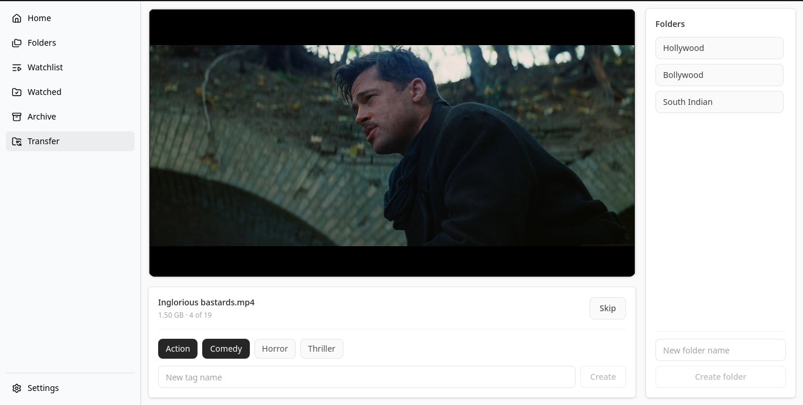
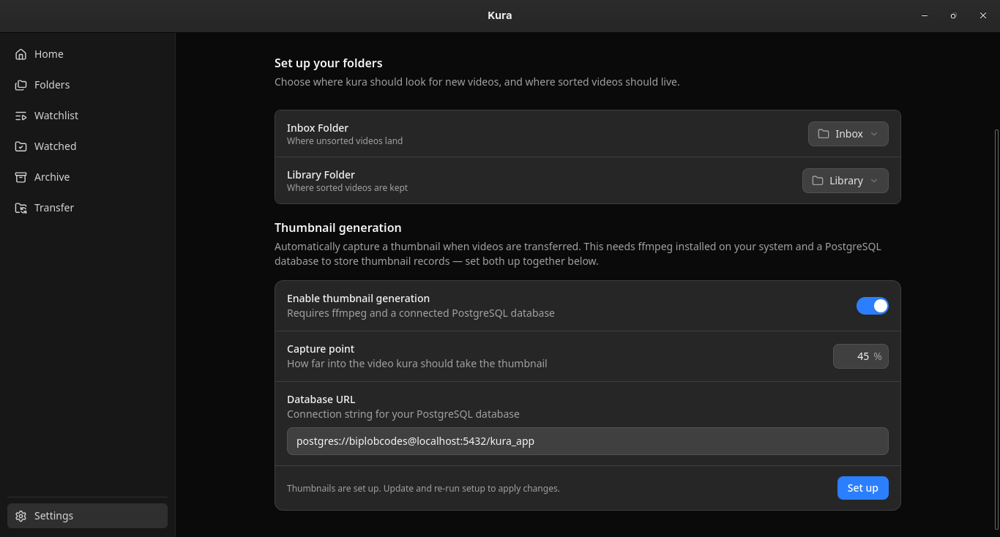

# Kura

Local video triage and organization. Sort an inbox of videos into folders, tag them, generate thumbnails, and keep track of what you’ve watched — all on your machine.

Built with **Tauri**, **React**, **TypeScript**, and **Rust**.

---

## Features

- **Inbox → Library workflow** — Point Kura at a drop folder and a library root. Work through new videos one by one and file them where they belong.
- **Folders & tags** — Organize into folders; attach tags while transferring so nothing gets lost in the pile.
- **Thumbnails** — Optional automatic thumbnail capture on transfer (ffmpeg + PostgreSQL).
- **Watchlist & watched** — Mark videos to watch later, mark them watched when you’re done, restore or trash from history.
- **Archive** — Soft-deleted videos stay browsable by month until you clear them for good.
- **Appearance** — Light, dark, or system theme.
- **Fully local** — Your files never leave your computer.

---

## Screenshots

### Transfer

Work through the inbox: preview the current video, pick tags, and move it into a folder.



### Settings

Configure inbox and library paths, theme, and optional thumbnail generation.



---

## Requirements

- [Node.js](https://nodejs.org/) 18+
- [pnpm](https://pnpm.io/)
- [Rust](https://www.rust-lang.org/tools/install) (stable)
- Platform dependencies for [Tauri 2](https://v2.tauri.app/start/prerequisites/)

**Optional (thumbnails):**

- [ffmpeg](https://ffmpeg.org/) on your `PATH`
- A running PostgreSQL instance

---

## Getting started

```bash
git clone https://github.com/biplob-codes/kura.git
cd kura
pnpm install
pnpm tauri dev
```
